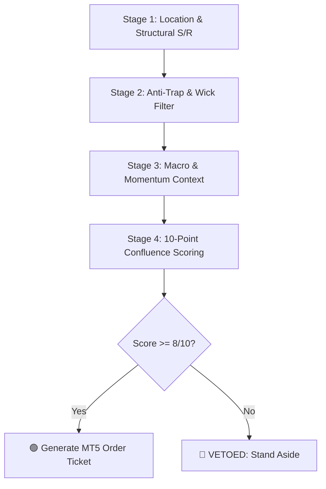

# Bottreding: Gold (XAU/USD) & Bitcoin (BTC/USD) Institutional Execution Engine

An institutional-grade, multi-factor algorithmic trading and risk management platform designed exclusively for **Gold (`XAU/USD`)** and **Bitcoin (`BTC/USD`)**. Integrates directly with **MetaTrader 5 (MT5)** on Windows and features interactive remote control and automated alerts via **Telegram**.

---

## ⚡ Key Highlights

- **Asset Focus:** Exclusively hard monetary assets — Gold and Bitcoin. Penny stocks, meme tokens, and low-liquidity equities are strictly vetoed.
- **Method 1 Deterministic Pipeline (`autotrader_pipeline.py`):** 4-stage mathematical pipeline enforcing structural location, wick/trap filtering, macro correlation, and a 10-point confluence matrix.
- **Microstructure Anti-Trap Verification (`detect_fakeout.py`):** Detects Wyckoff Springs (bear traps) and Upthrusts (bull traps) with $\ge 40\%$ wicks to avoid entering retail liquidity sweeps.
- **Key Levels & Fibonacci Engine (`find_levels.py`):** Calculates broken swing highs/lows (S/R flips), moving averages (50 SMA, 200 SMA), and the Fibonacci Golden Pocket ($0.618 - 0.650$).
- **Interactive Multi-Factor Terminal (`terminal.py`):** Real-time quantitative dashboard tracking the Mayer Multiple, Gold/Silver Ratio (GSR), DXY, US 10-Year Real Yields, and Crypto Fear & Greed.
- **MetaTrader 5 & Telegram Execution (`mt5_telegram_bot.py`):** Real-time Telegram alerts with inline execution buttons, live account monitoring, automatic 1% risk position sizing, stop-loss, and multi-tier take-profits.

---

## 🏗️ The 4-Stage Confluence Pipeline

Every trade signal must pass four strict gates:



1. **Stage 1: Location & Structure**
   - Price must be at or near an institutional key level: 50-day SMA, 200-day SMA, or the local Fibonacci Golden Pocket ($0.618 - 0.650$). No entering in "mid-air."
2. **Stage 2: Anti-Trap Verification**
   - Examines recent candle geometry for long wicks ($\ge 40\%$). If a bull trap formed at resistance, long orders are vetoed immediately.
3. **Stage 3: Macro & Momentum Context**
   - Inspects DXY (US Dollar Index), US 10Y Real Yields (`^TNX`), RSI(14), Bitcoin Mayer Multiple, and Fear & Greed Index.
4. **Stage 4: Confluence Scoring & Order Ticket Generation**
   - Setup scored on a 10-point matrix:
     - **9 - 10 / 10:** 🟢 **A+ Setup** (Full 1.0% Risk Size)
     - **7 - 8 / 10:** 🟡 **B Setup** (0.5% Risk Size)
     - **< 7 / 10:** 🔴 **VETOED** (Zero Execution Permitted)

---

## 📁 Repository Structure

```
Bottreding/
├── autotrader_pipeline.py    # 4-stage deterministic execution engine
├── mt5_telegram_bot.py       # Telegram controller & MetaTrader 5 execution bot
├── terminal.py               # Interactive hard-asset multi-factor dashboard
├── find_levels.py            # Key level, S/R flip & Fibonacci Golden Pocket scanner
├── detect_fakeout.py         # Bull/Bear trap and liquidity sweep analyzer
├── analyst.py                # Quantitative multi-factor asset analyst
├── risk.py                   # Strict 1% risk position sizing & lot calculator
├── screener.py               # Rule-based asset screener
├── budget.py                 # Capital allocation & portfolio tracker
├── rules.json                # Screener criteria and rule definitions
├── config_telegram.json      # Configuration for Telegram token & MT5 symbols
├── requirements.txt          # Python dependencies
└── README.md                 # System documentation
```

---

## 🛠️ Prerequisites & Installation

### 1. Requirements
- **OS:** Windows 10/11 (required for the official MetaTrader 5 Python integration).
- **Python:** **Python 3.11** (recommended; MetaTrader 5 wheels are supported on $\le 3.12$).
- **MetaTrader 5:** Installed and logged into your broker demo or live account.

### 2. Setup MetaTrader 5
1. Launch MetaTrader 5.
2. Go to **Tools** > **Options** > **Expert Advisors**.
3. Check **"Allow Algo Trading"** and check **"Allow WebRequest for listed URL"**.

### 3. Install Python Dependencies
Open PowerShell or Command Prompt:

```powershell
py -3.11 -m pip install -r requirements.txt
```

---

## ⚙️ Configuration (`config_telegram.json`)

Edit `config_telegram.json` with your credentials:

```json
{
  "telegram": {
    "bot_token": "YOUR_TELEGRAM_BOT_TOKEN_HERE",
    "chat_id": "YOUR_TELEGRAM_CHAT_ID_HERE"
  },
  "mt5": {
    "enabled": true,
    "symbols": {
      "BTC": "BTCUSD",
      "GOLD": "XAUUSD"
    },
    "risk_pct_per_trade": 1.0,
    "max_open_trades": 2
  },
  "pipeline": {
    "scan_interval_seconds": 1800,
    "min_confluence_to_alert": 8
  }
}
```

> **How to get Telegram credentials:**
> 1. Message `@BotFather` on Telegram and send `/newbot` to get your `bot_token`.
> 2. Message `@userinfobot` or send a message to your bot and check `https://api.telegram.org/bot<YOUR_TOKEN>/getUpdates` to get your numeric `chat_id`.

---

## 🚀 Running the Bot & Tools

### 1. Unified Telegram Bot + MT5 Controller
Runs the Telegram remote listener and initiates periodic automated scans every 30 minutes:

```powershell
py -3.11 mt5_telegram_bot.py
```

#### Supported Telegram Commands:
| Command | Action |
|---|---|
| `/start` | Connects session, verifies MT5 connectivity, and shows account balance |
| `/scan` | Triggers immediate multi-factor scan for Gold and Bitcoin |
| `/status` | Shows open MT5 positions, floating PnL, and live macro indicators |
| `/help` | Displays command list and instructions |

When a setup scores $\ge 8/10$, an alert is automatically sent to Telegram with an **"⚡ Execute MT5 Order"** button for 1-click execution.

---

### 2. Run Pipeline Directly via CLI
To test the deterministic pipeline directly in your terminal without Telegram:

```powershell
py -3.11 autotrader_pipeline.py
```

To run only for Gold:
```powershell
py -3.11 autotrader_pipeline.py --asset GOLD
```

To run only for Bitcoin:
```powershell
py -3.11 autotrader_pipeline.py --asset BTC
```

---

### 3. Interactive Multi-Factor Terminal
Launch the full quantitative analytics dashboard:

```powershell
py -3.11 terminal.py
```

---

### 4. Key Level & Golden Pocket Detector
Scan for S/R flips and Fibonacci levels:

```powershell
py -3.11 find_levels.py --symbol GC=F
py -3.11 find_levels.py --symbol BTC-USD
```

---

### 5. Liquidity Sweep & Fake Breakout Scanner
Audit recent candles for Wyckoff Springs and Upthrust traps:

```powershell
py -3.11 detect_fakeout.py --symbol GC=F
py -3.11 detect_fakeout.py --symbol BTC-USD
```

---

## 🛡️ Risk Management Guardrails

1. **Strict 1.0% Maximum Risk Per Trade:** Position sizes are mathematically calculated from the distance to the local stop-loss:
   $$\text{Lot Size} = \frac{\text{Account Balance} \times 0.01}{|\text{Entry} - \text{Stop Loss}| \times \text{Tick Value}}$$
2. **Minimum 1:2 Risk/Reward Ratio:** Trades must offer at least double the reward compared to risk to be approved.
3. **No Mid-Air Entries:** Setups far from structural support or resistance are immediately vetoed.
4. **Hard Veto Threshold:** Any score below 8/10 produces a strict **"VETOED: Stand Aside"** directive.

---

## 📄 License
This project is licensed under the Apache 2.0 License - see the [LICENSE](LICENSE) file for details.
