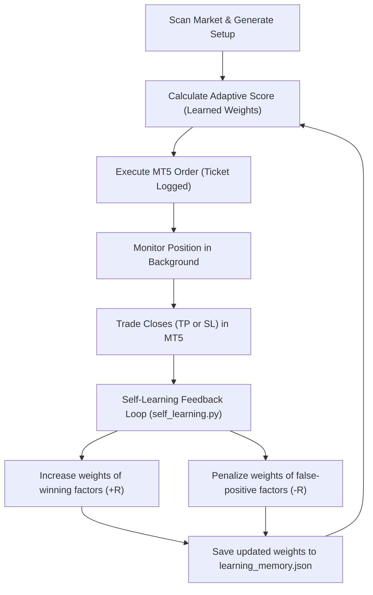
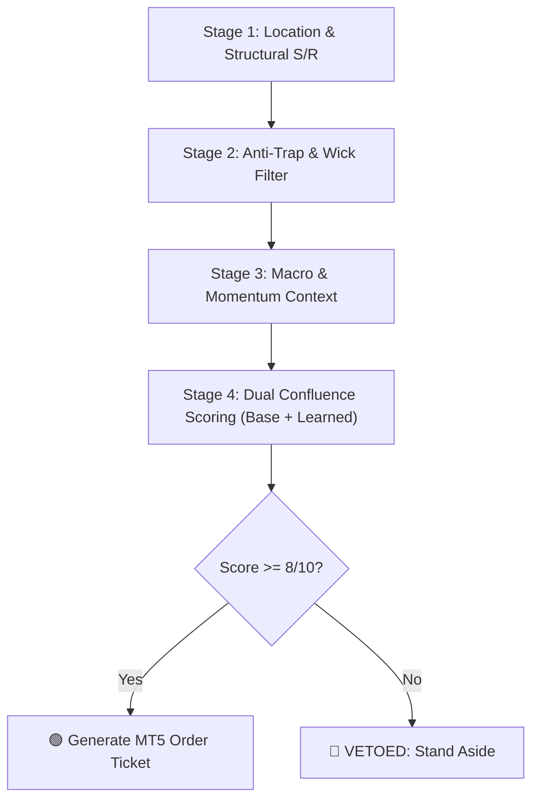

# Bottreding: Gold (XAU/USD) & Bitcoin (BTC/USD) Institutional Execution Engine

An institutional-grade, multi-factor algorithmic trading and risk management platform designed exclusively for **Gold (`XAU/USD`)** and **Bitcoin (`BTC/USD`)**. Integrates directly with **MetaTrader 5 (MT5)** on Windows and features interactive remote control, automated alerts, and **autonomous self-learning** via **Telegram**.

---

## ⚡ Key Highlights

- **Asset Focus:** Exclusively hard monetary assets — Gold and Bitcoin. Penny stocks, meme tokens, and low-liquidity equities are strictly vetoed.
- **Autonomous Self-Learning (`self_learning.py`):** Automatically logs all trade signals, evaluates actual outcomes from MetaTrader 5 closed deals, and dynamically adapts confluence factor weights using Bayesian online learning.
- **Method 1 Deterministic Pipeline (`autotrader_pipeline.py`):** 4-stage mathematical pipeline enforcing structural location, wick/trap filtering, macro correlation, and dual scoring (deterministic base score + learned adaptive score).
- **Microstructure Anti-Trap Verification (`detect_fakeout.py`):** Detects Wyckoff Springs (bear traps) and Upthrusts (bull traps) with $\ge 40\%$ wicks to avoid entering retail liquidity sweeps.
- **Key Levels & Fibonacci Engine (`find_levels.py`):** Calculates broken swing highs/lows (S/R flips), moving averages (50 SMA, 200 SMA), and the Fibonacci Golden Pocket ($0.618 - 0.650$).
- **Interactive Multi-Factor Terminal (`terminal.py`):** Real-time quantitative dashboard tracking the Mayer Multiple, Gold/Silver Ratio (GSR), DXY, US 10-Year Real Yields, and Crypto Fear & Greed.
- **MetaTrader 5 & Telegram Execution (`mt5_telegram_bot.py`):** Real-time Telegram alerts with inline execution buttons, live account monitoring, automatic 1% risk position sizing, stop-loss, and multi-tier take-profits.

---

## 🧠 Self-Learning & Adaptive Weight Optimization

The system features an autonomous feedback loop designed to improve performance over time without human intervention:



### 1. How It Self-Improves
1. **Dynamic Factor Weighting:** Initial factor weights start calibrated, but adjust dynamically between `0.35x` and `2.50x`. Factors that consistently yield winning $+2R$ trades receive higher scoring power; factors leading to false breakouts are penalized.
2. **Walk-Forward Historical Calibration:** Run `py -3.11 self_learning.py --train` to simulate and train factor weights across the past 180–365 days of Gold and Bitcoin price action.
3. **Automated Broker Feedback Sync:** The Telegram bot checks `mt5.history_deals_get()` every 10 minutes. When a trade hits Stop-Loss or Take-Profit in MT5, its outcome and R-multiple are instantly fed back to update factor weights.
4. **Immutable Guardrails:** The self-learning engine is strictly bounded:
   - Maximum risk per trade remains locked at 1.0%.
   - Stop-loss rules can never be widened or bypassed.
   - Minimum confluence execution threshold remains $\ge 8.0/10$.

---

## 🏗️ The 4-Stage Confluence Pipeline

Every trade signal must pass four strict gates:



1. **Stage 1: Location & Structure**
   - Price must be at or near an institutional key level: 50-day SMA, 200-day SMA, or the local Fibonacci Golden Pocket ($0.618 - 0.650$). No entering in "mid-air."
2. **Stage 2: Anti-Trap Verification**
   - Examines recent candle geometry for long wicks ($\ge 40\%$). If a bull trap formed at resistance, long orders are vetoed immediately.
3. **Stage 3: Macro & Momentum Context**
   - Inspects DXY (US Dollar Index), US 10Y Real Yields (`^TNX`), RSI(14), Bitcoin Mayer Multiple, and Fear & Greed Index.
4. **Stage 4: Confluence Scoring & Order Ticket Generation**
   - Setup evaluated on both deterministic 10-point scale and dynamic learned weights:
     - **9 - 10 / 10:** 🟢 **A+ Setup** (Full 1.0% Risk Size)
     - **7 - 8 / 10:** 🟡 **B Setup** (0.5% Risk Size)
     - **< 7 / 10:** 🔴 **VETOED** (Zero Execution Permitted)

---

## 📁 Repository Structure

```
Bottreding/
├── self_learning.py          # Self-learning & adaptive weight optimization engine
├── learning_memory.json      # Persistent learning memory & trade journal
├── autotrader_pipeline.py    # 4-stage pipeline with dual confluence scoring
├── mt5_telegram_bot.py       # Telegram controller, MT5 execution & auto-sync
├── terminal.py               # Interactive hard-asset multi-factor dashboard
├── find_levels.py            # Key level, S/R flip & Fibonacci Golden Pocket scanner
├── detect_fakeout.py         # Bull/Bear trap and liquidity sweep analyzer
├── analyst.py                # Quantitative multi-factor asset analyst
├── risk.py                   # Strict 1% risk position sizing & lot calculator
├── screener.py               # Rule-based asset screener
├── budget.py                 # Capital allocation & portfolio tracker
├── rules.json                # Screener criteria and rule definitions
├── config_telegram.json      # Configuration for Telegram token & MT5 symbols
├── requirements.txt          # Python dependencies
└── README.md                 # System documentation
```

---

## 🛠️ Prerequisites & Installation

### 1. Requirements
- **OS:** Windows 10/11 (required for the official MetaTrader 5 Python integration).
- **Python:** **Python 3.11** (recommended; MetaTrader 5 wheels are supported on $\le 3.12$).
- **MetaTrader 5:** Installed and logged into your broker demo or live account.

### 2. Setup MetaTrader 5
1. Launch MetaTrader 5.
2. Go to **Tools** > **Options** > **Expert Advisors**.
3. Check **"Allow Algo Trading"** and check **"Allow WebRequest for listed URL"**.

### 3. Install Python Dependencies
Open PowerShell or Command Prompt:

```powershell
py -3.11 -m pip install -r requirements.txt
```

---

## ⚙️ Configuration (`config_telegram.json`)

Edit `config_telegram.json` with your credentials:

```json
{
  "telegram": {
    "bot_token": "YOUR_TELEGRAM_BOT_TOKEN_HERE",
    "chat_id": "YOUR_TELEGRAM_CHAT_ID_HERE"
  },
  "mt5": {
    "enabled": true,
    "symbols": {
      "BTC": "BTCUSD",
      "GOLD": "XAUUSD"
    },
    "risk_pct_per_trade": 1.0,
    "max_open_trades": 2
  },
  "pipeline": {
    "scan_interval_seconds": 1800,
    "min_confluence_to_alert": 8
  }
}
```

---

## 🚀 Running the Bot & Tools

### 1. Unified Telegram Bot + MT5 Controller + Self-Learner
Runs the Telegram remote listener and initiates periodic automated scans and MT5 trade outcome synchronization:

```powershell
py -3.11 mt5_telegram_bot.py
```

#### Supported Telegram Commands:
| Command | Action |
|---|---|
| `/start` | Connects session, verifies MT5 connectivity, and shows account balance |
| `/scan` | Triggers immediate multi-factor scan with Base & Learned Adaptive Scores |
| `/status` | Shows open MT5 positions, floating PnL, and live macro indicators |
| `/learn` | Displays current factor weights, trade count, and win-rate rankings |
| `/train` | Runs walk-forward self-calibration on historical price data |
| `/sync` | Syncs closed deals from MT5 history to adapt weights |
| `/execute_btc` | Executes BTC order with calculated 1% risk lot sizing and brackets |
| `/execute_gold` | Executes Gold order with calculated 1% risk lot sizing and brackets |
| `/help` | Displays command list and instructions |

---

### 2. Run Self-Learning Engine Directly via CLI
Inspect current weights, run walk-forward training, or audit factor rankings:

```powershell
# View current learned factor weights and performance metrics
py -3.11 self_learning.py --summary

# Train on the past 365 days of historical data
py -3.11 self_learning.py --train --days 365

# Sync closed deals from connected MT5 terminal
py -3.11 self_learning.py --sync
```

---

### 3. Run Pipeline Directly via CLI
Test the deterministic pipeline directly in your terminal:

```powershell
py -3.11 autotrader_pipeline.py
```

---

### 4. Interactive Multi-Factor Terminal
Launch the full quantitative analytics dashboard:

```powershell
py -3.11 terminal.py
```

---

### 5. Key Level & Golden Pocket Detector
```powershell
py -3.11 find_levels.py --symbol GC=F
py -3.11 find_levels.py --symbol BTC-USD
```

---

### 6. Liquidity Sweep & Fake Breakout Scanner
```powershell
py -3.11 detect_fakeout.py --symbol GC=F
py -3.11 detect_fakeout.py --symbol BTC-USD
```

---

## 🛡️ Risk Management Guardrails

1. **Strict 1.0% Maximum Risk Per Trade:** Position sizes are mathematically calculated from the distance to the local stop-loss.
2. **Minimum 1:2 Risk/Reward Ratio:** Trades must offer at least double the reward compared to risk to be approved.
3. **No Mid-Air Entries:** Setups far from structural support or resistance are immediately vetoed.
4. **Hard Veto Threshold:** Any score below 8/10 produces a strict **"VETOED: Stand Aside"** directive.

---

## 📄 License
This project is licensed under the Apache 2.0 License - see the [LICENSE](LICENSE) file for details.
